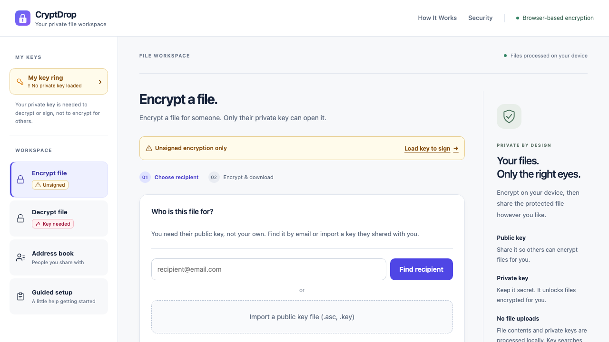

# CryptDrop design system

Issue [#2](https://github.com/nilushan/CryptDrop/issues/2) · documentation baseline v1

## Status and implementation baseline

This is a source-backed inventory and implementation contract, **not a shipped UI refactor or an accessibility certification**. Audited source: `ee7e3085d7005cac68852c059286111cabdfdaaf` on `feat/portfolio-customer-improvements`. All runtime source, cryptography, storage behavior, and public claims remain unchanged in #2. Independent review is the approval gate before dependent work begins. Review acceptance establishes this baseline; this document does not imply prior human sign-off.

The baseline follows the issue's agreed direction:

- Keep Astro 5, React 19 islands, Nano Stores, OpenPGP.js, and handwritten CSS. The Tailwind-like utility names in Layout are custom CSS, not a Tailwind installation.
- Share foundations and interaction rules, **not one component treatment everywhere**. Keep the app's quiet, task-focused light workspace and denser controls; keep marketing's expressive heroes, illustrations, and roomier reading layouts.
- Retain indigo actions/selection, blue-teal private-key surfaces, green public-key surfaces, and icon-plus-text capability warnings. A green loaded-key indicator means session availability, not identity verification or a verified backup.
- Reuse existing components before adding primitives. Preserve URLs, tab state/focus behavior, native file pickers, optional signing, and backup verification gates.
- Extract styling in small surface-specific steps. No framework migration, theme switcher, new icon library, component package, or speculative design-system runtime.
- Do not change encryption, recovery policy, registration, key persistence, or security/privacy wording under the guise of visual cleanup. Content discrepancies below are review inputs, not approved replacement claims.

### Follow-up implementation record

Issue #4 implements the app catalog described by this historical #2 baseline (pending independent review). `src/styles/tokens.css`, `app-components.css` and the bounded `feedback.css` now exist; Layout imports tokens once, the app imports its scoped catalog before workspace overrides, and invitation imports feedback only. #3's FormField/labels are reused. [The exhaustive #4 audit](design-system-evidence/issue-4/audit.md) covers every component, removal/consumer checks, shared patterns and intentional exceptions. [#4 evidence and validation](design-system-evidence/issue-4/README.md) records before/after views, actual browser coverage and remaining pre-existing checks. Statements below about “planned” paths or “currently” missing semantics describe the original audited commit, not the updated implementation.

Issue #5 implements the homepage marketing catalog and shared marketing shell (pending independent review). `src/styles/marketing.css` now owns token-backed static reading/action/card/table roles and marketing-only shell focus/motion/navigation. [MarketingSection](../src/components/marketing/MarketingSection.astro) requires a unique `id` and `heading`, with optional `lead` and `plain|muted|gradient` tone; it renders a named section, h2 and 56rem container. [MarketingCTA](../src/components/marketing/MarketingCTA.astro) requires `href`, accepts primary/secondary variant and text slot, and always renders a native link without hydration. Compose CTA links in `.marketing-cta-group`; table callers must still supply caption, scopes and named/described keyboard-scroll region. One-off hero artwork and static step layout remain local, not app controls. [#5 audit, approved claim reconciliation, intentional exceptions and responsive evidence](design-system-evidence/issue-5/README.md) records the actual implementation and validation. Known false homepage no-backend/no-database absolutes are corrected with supervisor-approved source-backed wording; wider cross-route consistency and third-party comparison assertions remain owner-review inputs.

Issue #6 applies the existing marketing catalog to the complete How It Works guide (pending independent review). Five named `MarketingSection` chapters, the shared CTA, card/table styles and tokens replace local duplicates; original illustrations and nine-step DOM order remain. Guide-specific warm-to-cool chapter art and alternating layout are intentional, not new reusable APIs. The analogy table uses the existing named keyboard-scroll region contract with caption and scoped headers. Hover image scaling is removed entirely. [#6 section audit, approved accuracy reconciliations, responsive evidence and validation](design-system-evidence/issue-6/README.md) records the implementation and limitations. No new shared component or shared-layout change was needed.

### Reading map

1. [Inventory and gaps](#inventory-and-gaps)
2. [Shared foundations](#shared-foundations)
3. [App pattern catalog](#app-pattern-catalog)
4. [Marketing and content pattern catalog](#marketing-and-content-pattern-catalog)
5. [Ownership and reuse](#ownership-and-reuse)
6. [Usage examples](#usage-examples)
7. [Accessibility acceptance checklist](#accessibility-acceptance-checklist)
8. [Migration order and decisions](#migration-order-and-decisions)
9. [Visual references and validation](#visual-references-and-validation)

## Inventory and gaps

### Pages and states

| Surface / source | Existing reusable structure | Gaps / follow-up |
| --- | --- | --- |
| `/`: [index.astro](../src/pages/index.astro) | Centered gradient hero, paired CTAs, trust text, explanatory image, problem/solution feature grids, numbered three-step explanation, comparison table, closing CTA | Local button definitions duplicate app names; inline colors/spacing; small gray copy and comparison footnote; table has no caption/row headers or textual yes/no labels. Preserve image and narrative hierarchy, not duplicated CSS. Claim contradictions need owner review in #5, not silent copying. |
| `/how-it-works`: [how-it-works.astro](../src/pages/how-it-works.astro) | Warm-to-cool chapter backgrounds, image/text scenes, nine alternating story steps, step connectors, analogy map, closing CTA | Hero/sections/badges duplicate other pages. Hover image scaling lacks marketing reduced-motion treatment. At 375px the analogy table is ~419px wide and document is 443px wide: real reflow gap for #6. Alternating visual order must not change reading order. |
| `/security`: [security.astro](../src/pages/security.astro) | Dark hero, local-operation grid, private-key protections/limits, network disclosure cards, never-transmitted list, hardening grid, source/app links | Security **and privacy share this route**, not `/privacy`. Dense repeated card/badge styles and inline CTAs; local/network/never categories must remain textually distinct, not just green/amber/red. Preserve `#private-key-security` and its caveats. Coordinate #7 layout and #8 content review. |
| `/app`: [index.astro](../src/pages/app/index.astro), [app-workspace.css](../src/styles/app-workspace.css) | White header, desktop sidebar, separate My key ring entry, four tool tabs, task area, explanatory aside, compact footer, skip link, URL-selected panels | App styles split between Layout utilities, page-global legacy rules, workspace overrides, and React inline styles. Duplicate button/card/input families and some unused old shell selectors. Do not delete a selector until consumer search confirms it is unused. |
| Encrypt: [EncryptTab](../src/components/encrypt/EncryptTab.tsx), [QuickEncryptPanel](../src/components/encrypt/QuickEncryptPanel.tsx) | Recipient lookup/import or saved contact, unsigned capability notice, step list, file selection, optional signing, processing, result/download, folder selection, history | Keep private-key absence separate from recipient-key absence. Inline panels/results need semantic styles; preserve selected files and focus when moving between panels. Empty/recipient-selected/busy/result/error states all matter in #4. |
| Decrypt: [DecryptTab](../src/components/decrypt/DecryptTab.tsx), [DecryptFilePanel](../src/components/shared/DecryptFilePanel.tsx) | Matching-key notice, native file input, sender key selection, disabled unlock, result/signature status, expiry and folder/history controls | Do not equate successful decryption with verified signature. Keep unknown/not-checked/failed/verified distinct. Long filenames, disabled explanation, and persistent errors need consistent treatment. |
| Keyring: [KeyRingTab](../src/components/keys/KeyRingTab.tsx), [PrivateKeyPanel](../src/components/keys/PrivateKeyPanel.tsx) | Security disclosure, no-key/saved-key states, generate/import choices, loaded-key view and public-key view | Current generate inputs use placeholders only; name/email stay two columns even at 375px (~143px input widths). Import passphrase also lacks a visible label. Restore has an accessible name and inline alert, but help/error association is incomplete. #3 addresses generation first; #4 completes other forms. |
| Key generation / import / backup | [KeyGenerateForm](../src/components/keys/KeyGenerateForm.tsx), [KeyImportForm](../src/components/keys/KeyImportForm.tsx), [KeyLoadedView](../src/components/keys/KeyLoadedView.tsx), [KeyBackupGuide](../src/components/keys/KeyBackupGuide.tsx), [YourPublicKey](../src/components/keys/YourPublicKey.tsx) | Preserve passphrase rules, automatic downloads, post-generation backup gate, collapsed backup guidance, remember/forget restrictions and public/private distinction. Styling must not imply saving, downloading, and verified recovery are equivalent. Label/helper/error patterns should extend existing backup-field associations. |
| Contacts: [AddressBookTab](../src/components/keys/AddressBookTab.tsx), [AddressBook](../src/components/keys/AddressBook.tsx), [ContactKeyList](../src/components/keys/ContactKeyList.tsx) | Public-key lookup/import, optional name prompt, empty list, fingerprint rows, refresh/remove actions | Small pale green fingerprints/actions, inline name prompt without visible label, weak icon-only remove naming/target size. Preserve full fingerprint access; do not replace it with a trust checkmark. |
| Guided setup: [WizardTab](../src/components/wizard/WizardTab.tsx), [WizardHome](../src/components/wizard/WizardHome.tsx), [WizardProgress](../src/components/wizard/WizardProgress.tsx) | Branch choices, progress/back navigation; [recipient](../src/components/wizard/WizardEncryptRecipient.tsx), [decrypt key](../src/components/wizard/WizardDecryptKeys.tsx), [decrypt file](../src/components/wizard/WizardDecryptFile.tsx) compositions | Use the same key forms, file, lookup and result components as direct tasks. Verify step focus and back-state retention; no separate crypto or form implementation for the wizard. |
| `/invite`: [invite.astro](../src/pages/invite.astro), [InviteAcceptPage](../src/components/invite/InviteAcceptPage.tsx) | Marketing shell with compact 480px onboarding card; validating, missing/invalid/used/failure, valid invitation and setup-link states | Neutral stone CTA and blue fallback link are exceptions to indigo. No page h1; loading/error updates lack explicit live-status semantics. `.invite-success` CSS exists but no success branch currently renders it. Preserve token forwarding; do not invent a success state or email-delivery guarantee. Only missing-token state browser-tested here. |
| Shared shell: [Layout.astro](../src/layouts/Layout.astro) | Logo, named site navigation, active underline, footer attribution; appMode selects app shell behavior | Marketing informational nav disappears below 540px without a menu; app header links disappear below 760px (other security links remain in workspace). Skip link and broad focus treatment exist only in app. Footer `text-gray-400` is too faint. Address discoverability without forcing a mobile navigation redesign in #2. |

### Cross-surface gap register

| ID | Evidence | Implementation disposition |
| --- | --- | --- |
| G1: labels and help | Generation name/email/passphrase have zero associated labels and no aria-label; browser accessibility names fall back to placeholders. KeyImportForm and optional contact-name prompt are similar. | #3 generation labels/help; #4 other app fields. Persistent visible labels, unique IDs, help/error associations; never use placeholders as labels. |
| G2: contrast | Legacy `#9ca3af` on white 2.54:1; white on green `#16a34a` 3.30:1 or amber `#d97706` 3.19:1; public action green `#059669` on white 3.77:1. | #4 app and #5–#8 content: semantic pairs below, measure actual backgrounds/opacity and states. These values fail normal-text 4.5:1. |
| G3: control boundaries/focus | App input border `#cdd5e0` on white 1.48:1; focus `#818cf8` on white 2.98:1. App has outline/offset behavior; marketing mostly relies on native defaults. | #4 and marketing follow-ups: keep focus behavior, strengthen colors and required control boundaries; decorative separators need not be 3:1. |
| G4: announcements | NoticeBox is a plain div; Toast has no live region; ActionButton changes text/disables but lacks explicit busy semantics; invitation is plain loading/error text. | Extend semantics at actual dynamic owner; don't turn every static notice into an alert. Errors cannot rely only on disappearing toasts. |
| G5: responsive access | Guide document overflow 443px at 375px; informational header links hidden on small screens; tiny app metadata/targets and tight key-generation columns. | #4–#8: local table scroller or reflow, recoverable navigation, stacked fields and adequately spaced targets. Keep document overflow out of normal content. |
| G6: duplication | `.btn-primary`, `.card`, animations and badges split across page/global/inline rules; status hues drift between notices, result, toast, key views. | Extract with a consumer audit and screenshot comparison; do not merge private/public semantics into generic success. |
| G7: motion and semantics | Marketing hover transforms lack reduced-motion override; comparison/analogy tables lack captions/scopes; invitation h1 absent; decorative SVG/emoji treatment varies. | Apply accessibility checklist in each owning issue; retain meaningful textual explanations alongside illustrations. |
| G8: content consistency | Homepage says “no backend, no database” while `/security` describes network services; generation note says “Never sent” while code attempts public identity/key registration. README/footer/guide also contain broad absolutes. | **Unresolved content review, not new approved claims.** Route to #5/#6/#7/#8 and owner; verify against source before changing wording. Do not treat visual reference text as endorsed claims. |

## Shared foundations

### Semantic color contract

Names below describe the **planned CSS custom properties** for extraction, not variables already installed by #2. Existing app/vault names remain aliases during migration. Use one spelling per role; do not add numeric color scales to each component. Default light surfaces only; no dark mode is proposed. Dark marketing heroes are intentional sections, not an app theme.

| Planned token | Baseline value | Current source / use |
| --- | --- | --- |
| `--cd-color-page` / `--cd-color-surface` | `#f9fafb` / `#ffffff` | Layout page and cards; app page override stays `#f7f8fa` via `--app-bg` |
| `--cd-color-ink` / `--cd-color-muted` | `#1f2937` / `#4b5563` | Shared readable text; app aliases preserve `--app-ink: #18243b`, `--app-muted: #5d6a7e` |
| `--cd-color-action` / `--cd-color-action-hover` / `--cd-color-on-action` | `#4f46e5` / `#4338ca` / `#ffffff` | Primary action, app selection; `--app-accent` aliases action |
| `--cd-color-info-bg` / `--cd-color-info-ink` | `#eef2ff` / `#3730a3` | Informational notices and indigo selection text; existing app soft surface `#eef0ff` may remain scoped |
| `--cd-color-success-bg` / `--cd-color-success-ink` | `#f0fdf4` / `#166534` | Operation success; loaded-key availability still requires explicit text |
| `--cd-color-warning-bg` / `--cd-color-warning-ink` | `#fffbeb` / `#854d0e` | Unsigned/limited capability, recovery caution |
| `--cd-color-error-bg` / `--cd-color-error-ink` | `#fff1f2` / `#9f1239` | Blocked capability or error, with reason and recovery action |
| `--cd-color-line` / `--cd-color-control-border` | `#e1e6ee` / `#6b7280` | Decorative dividers versus necessary input/control boundaries. Stronger boundary is a remediation target, not current appearance. |
| `--cd-color-focus` | `#4f46e5` | Remediation target for current pale focus; offset it from similarly colored controls with a surface gap |
| Existing `--vault-*` family | surface `#edf5f7`, tint `#dcecef`, border `#b6cfd6`, ink `#173f4c`, muted `#486674`, accent `#0f6173`, hover `#0c4e5e`, raised white | Keep private-key visual identity scoped to vault components; do not replace with status green |

Calculated sRGB contrast reference (opaque pairs, rounded to two decimals):

| Foreground / background | Ratio | Intended check |
| --- | --- | --- |
| Ink `#1f2937` / white | 14.68:1 | Body |
| Muted `#4b5563` / white | 7.56:1 | Help/prose |
| App muted `#5d6a7e` / app page `#f7f8fa` | 5.16:1 | Workspace copy |
| White / action `#4f46e5` | 6.29:1 | Button text |
| Info `#3730a3` / `#eef2ff` | 8.88:1 | Info text |
| Success `#166534` / `#f0fdf4` | 6.81:1 | Success text |
| Warning `#854d0e` / `#fffbeb` | 6.61:1 | Warning text |
| Error `#9f1239` / `#fff1f2` | 7.30:1 | Error text |
| Vault muted `#486674` / `#edf5f7` | 5.54:1 | Private help |
| White / vault action `#0f6173` | 7.05:1 | Vault button |
| Control border `#6b7280` / white | 4.83:1 | Non-text boundary (3:1 target) |

Measure rendered combinations again when changing opacity, tint, gradients, hover or disabled states. Text targets: 4.5:1 normal, 3:1 large (at least 24px regular or about 18.7px bold). Necessary control graphics/boundaries: 3:1 against adjacent colors. Inactive controls are exempt, but must remain understandable with adjacent explanation. Decorative colors are not valid text tokens automatically.

### Typography, spacing and sizing

| Foundation | Baseline / application |
| --- | --- |
| Family | Keep system sans stack from Layout; inherit it in controls. System monospace only for fingerprints, code and technical identifiers; no webfont requirement. |
| Weight | 400 copy, 500 labels, 600–700 controls/headings. App currently uses 550/650 and may retain them; marketing display 800 is intentional. |
| Text scale | 12px metadata, 14px compact app/card copy, 16px main body/input, 18px marketing lead, 20/24/28/32px headings, 36–52px marketing display. Use rem equivalents. Existing 9–11px microcopy is audit debt, not a recommended size for instructions. |
| Line height / measure | Body/help 1.5–1.7; long prose up to 1.8. Display 1.15–1.25. Reading copy about 34–40rem, outer content 56rem. Avoid truncating required instructions; wrap long fingerprints/filenames or offer accessible full text. |
| Spacing scale | 4, 8, 12, 16, 20, 24, 32, 48, 64px (`.25`, `.5`, `.75`, `1`, `1.25`, `1.5`, `2`, `3`, `4rem`). 2px only for tight icon/badge details. Keep larger section rhythm distinct from app control rhythm. Planned tokens `--cd-space-1` through `--cd-space-9` follow this order. |
| Controls | App primary action at least 44px high; fields 46px currently, 16px font on mobile; marketing CTA about 48px. WCAG 2.2 AA pointer target minimum 24×24 CSS px or sufficient spacing; 44px is the preferred touch target, not an assertion every existing action meets it. Compact 32/36px controls require spacing checks. |
| Radius | 6px compact badges, 8px controls, 12px content cards, 16px workspace/vault cards, pill only for statuses/step numbers. Keep app controls' current 10px as a documented scoped exception during extraction. Planned roles: `--cd-radius-control`, `--cd-radius-card`, `--cd-radius-panel`; do not invent one-off radii per new component. |
| Border | 1px standard separator/control, dashed for drop areas, selected inset 3px plus text/ARIA. Borders carrying interaction affordance use control-border, not decorative line. |
| Elevation | Flat workspace shell; subtle card shadow (`0 3px 12px rgb(24 36 59 / .025)`) only where already used. Marketing illustrations may keep deeper shadows. Toast overlays above content, never above required focus or sticky header by accident. Existing header z100, app skip link z200, toast z50 are audit inputs, not a universal layer scale. |
| Icons | Reuse inline 24-unit SVG paths, `currentColor`, usually 16/20/24px with 1.5–2px stroke. Decorative icons `aria-hidden="true"`; icon-only buttons need an accessible action name and target area. Marketing emoji/art can remain decorative with adjacent text; do not use lock imagery as a certification badge. |
| Focus | Visible outline 3px, offset 3–4px; never remove native focus without replacement. Ensure contrast on white, tinted and dark surfaces, and no sticky-header clipping/obscuring. Use `:focus-visible` and drop-zone `:focus-within`; not hover-only feedback. |
| Motion | Existing interaction transitions 150–200ms; fade 300ms; lock animation is an optional result illustration. Extend `prefers-reduced-motion: reduce` to marketing as well as app: remove transforms, fades and nonessential loops, retain textual busy state. No new auto-playing animations. |

### Layout and responsive contract

- App: preserve max shell 1680px; sidebar 248px, 220px at ≤1150px; task plus 220px guide above 1150px; guide stacks below tasks at ≤1150px. At ≤760px switch to 64px header and four fixed tool columns, with separate Keyring entry above. No horizontal scrolling tool strip. At ≤420px setup choice cards stack. Normal mobile task gutters 16px.
- Marketing/content: max outer 56rem with 24px gutters, prose/lead 34–40rem; homepage hero content 44rem. Existing grid steps: 640px card/two-column layouts, 768px story pairs/display text, 900px homepage three-column features. The 760px app threshold and 768px story threshold intentionally serve different layouts; do not mechanically replace them all with one breakpoint.
- Current 540px marketing link-hiding breakpoint is a **gap**, not the target navigation model. Follow-up work must keep How It Works and Security discoverable on mobile without hiding the primary app CTA.
- Single-column content first. Name/email/help must reflow without clipped labels, values or error messages at 320 CSS px and 200% text zoom. Evaluate 400% browser zoom/reflow at equivalent 320px width. Do not shrink text to make columns fit.
- Tables may use a clearly named, keyboard-scrollable local overflow region; document-level horizontal overflow is not acceptable. Keep row/header relationships, caption and visible scroll affordance. Images scale proportionally; source order must make sense with CSS off.

## App pattern catalog

These patterns serve Encrypt, Decrypt, Keyring, Contacts and Guided setup. They are not marketing layout components.

| Pattern / owner | Reuse and state contract |
| --- | --- |
| Navigation: [app-navigation.ts](../src/lib/app-navigation.ts), [KeyStatusPill](../src/components/shared/KeyStatusPill.tsx) | Preserve tablist/tab/tabpanel IDs, roving tab index, selected state, URL `?tab=`, desktop Up/Down and mobile Left/Right, Home/End, and one visible panel. Separate Keyring is a button/region, not a fifth tool tab. Cross-panel actions transfer focus out of the hidden panel. Key absence never disables navigation/file selection. |
| Buttons: [ActionButton](../src/components/shared/ActionButton.tsx) + existing `.btn-*` | Primary filled indigo, secondary outlined neutral, ghost for low emphasis, danger named explicitly, vault/public variants scoped. ActionButton already accepts loading text and className; extend it rather than duplicating spinners. Loading disables repeat submit and retains a visible verb (“Generating…”). Future busy semantics must not rely on animation. Set `type="button"` for non-submit buttons when placed in forms. |
| Fields: existing `.input` / `.search-input`, bounded new `FormField` in #3/#4 | Persistent visible label, optional/required cue, associated help and inline error, unique IDs across islands. Password responsibility must be next to the field, not only a tooltip/toast. Placeholder is an example only. Do not implement passphrase validation or storage inside a visual wrapper. Native input type/autocomplete remain caller-owned. |
| Cards/choices: existing `.card`, `.encrypt-panel`, [KeyChoiceGrid](../src/components/shared/KeyChoiceGrid.tsx) | Neutral card groups related controls under a heading; card is not clickable by default. Choice cards use real buttons with labelledby/describedby; no nested links/buttons. Keep filled generate vs outlined import hierarchy and private blue-teal treatment. |
| Notices: [NoticeBox](../src/components/shared/NoticeBox.tsx), [KeyCapabilityNotice](../src/components/shared/KeyCapabilityNotice.tsx), [KeySecurityDisclosure](../src/components/keys/KeySecurityDisclosure.tsx) | NoticeBox supports info/warn/success, not error today. Reuse visual container but add semantics only where needed. Capability uses existing text/icon plus `role="status"`; static guidance stays ordinary text. Native details/summary for security disclosure remains keyboard operable. Important limitation stays reachable when collapsed. |
| Files: [FileDropZone](../src/components/shared/FileDropZone.tsx), [FileSelectedCard](../src/components/shared/FileSelectedCard.tsx), [FolderBar](../src/components/shared/FolderBar.tsx) | Preserve native visually hidden input, click/keyboard alternative to drag/drop, focus-within, accept hints and same-file reselection. `accept` is a picker hint, not validation. Selected file shows name/size and named remove action; long names cannot hide actions. Folder selection is progressive enhancement; download fallback remains available. |
| People/keys: [ContactAvatar](../src/components/shared/ContactAvatar.tsx), [ContactListPicker](../src/components/shared/ContactListPicker.tsx), [ContactKeyList](../src/components/keys/ContactKeyList.tsx) | Share avatar/search/row styling, not a single component combining selectable recipient and editable contact management. Keep email and fingerprint access, search-empty versus no-contacts distinction, named refresh/remove actions. No decorative status should imply verified identity. |
| Lookup/invite: [KeyLookupCard](../src/components/shared/KeyLookupCard.tsx), [KeyLookupWithInvite](../src/components/shared/KeyLookupWithInvite.tsx), [InviteBox](../src/components/shared/InviteBox.tsx) | Compose lookup/import with invitation fallback, not duplicate API state. Idle, searching, key found (possibly warnings), not found/invite, request failure, sending, sent/fallback need text. Public-key lookup/network disclosure stays near action. No real requests needed for visual fixture tests. |
| Results: [ResultState](../src/components/shared/ResultState.tsx), [SignatureResult](../src/components/shared/SignatureResult.tsx), [LockIllustration](../src/components/shared/LockIllustration.tsx) | Keep original/result names, sizes, download and reset action. Do not derive new crypto truth from color or illustration. Existing signature outcomes must remain distinct and driven by existing logic. Reuse result component in guided/direct flows; extract inline styles without rewriting signature classification in a styling task. |
| Feedback/history: [Toast](../src/components/shared/Toast.tsx), [ActivityHistory](../src/components/shared/ActivityHistory.tsx) | Toast supplements, never replaces durable field/form errors. Add polite announcements without moving focus; use assertive alerts only for immediate errors requiring attention. History is a list of local operations, not a secure audit log; preserve clear/auto-clear controls and avoid screenshotting real names/files. |
| Key lifecycle: key components listed above | Preserve choice → generate/import → loaded and generation → backup verification → Done. Remembered/encrypted-at-rest, unlocked-in-session, downloaded and recovery-verified are separate states. KeyBackupGuide and `useKeyProtection` remain functional owners; no visual primitive gets access to keys or passphrases beyond its existing controlled-field contract. |

### State vocabulary for every interactive pattern

| State | Required presentation / behavior |
| --- | --- |
| Idle | Label, instruction and available action; no false success badge. |
| Empty | Say what is missing and offer the next action; distinguish no data from filtered no matches. |
| Loading | Verb-specific text plus optional decorative spinner; prevent duplicate action, announce once, retain layout. |
| Disabled | Native disabled where applicable plus visible reason/next step outside disabled control; never disable unrelated navigation. |
| Success | Explicit outcome and next action; download is not proof of verified recovery or delivery. |
| Warning / limited | Explain what remains possible and what is unavailable; icon + words, not amber alone. |
| Error / blocked | Durable message near cause; preserve recoverable non-secret data and provide retry/fix path. Do not extend passphrase retention. Associate field errors with input, mark invalid only when actually invalid. |
| Focus / hover / active | Keyboard-visible focus independent of hover; selected tab has shape/ARIA/text cues. No essential guidance available only on hover. |

## Marketing and content pattern catalog

Static Astro markup is the default. Content pages do not need React hydration merely to share appearance with the app.

| Pattern | Existing reference / intended reuse |
| --- | --- |
| Header/footer | Layout owns brand, named navigation, route state and attribution. App mode intentionally uses white header, workspace tagline and no marketing footer. Marketing retains dark indigo gradient header and light footer; improve focus, contrast and small-screen link access in follow-ups without duplicating shell markup. |
| Hero | Homepage `.landing-hero` is pale indigo/lilac with 40–52px display; guide `.hero-section` uses warm problem palette and 36–44px display; Security `.security-hero` is dark with light text. These are intentional tone differences with shared spacing/type roles, not three unrelated systems. |
| Section/prose | Reuse centered container, section heading/lead and consistent 32–64px rhythm. App task headings are smaller/tighter. Give substantive sections semantic headings/landmarks; use about 16px main prose, compact 14px card copy where suitable. Do not wrap every paragraph in a card. |
| Feature/disclosure cards | Homepage feature cards explain benefits; Security local/cloud/hardening cards explain data categories. Share border/radius/padding roles, retain their different information structures. Static cards must not look like app choice buttons. Headings and text state the category even without color. |
| Explanatory diagrams | Keep existing hero artwork and story images in `public/images/`; add adjacent explanations and meaningful alt text, not baked-in text as the only explanation. Use figure/figcaption where helpful. Alternating story steps remain understandable in DOM order. Decorative arrows/connectors are hidden from assistive tech. |
| Step sequences | Homepage three-step summary and guide nine-step story can share numbered step styling, not the app's live workflow progress state. Use ordered lists for meaningful sequences; no interactive/selected affordance on static steps. |
| Comparison / analogy tables | Homepage comparison and guide analogy map need captions, column/row header scope and textual meanings for symbols. Keep local horizontal scroll when two-dimensional relationships require it. Comparison assertions require product/security review, not design-system authority. |
| Calls to action | Navigation uses links; actions use buttons. One clear primary app link, secondary guide/source link where appropriate; shared action colors, roomier marketing spacing. Existing inline Security CTAs and guide utility CTA should migrate to the marketing CTA class/component, not hydrate ActionButton. |
| Invitation bridge | Keep marketing shell with 480px onboarding card and app-oriented setup destination. Align typography/action/focus tokens, but do not transplant the full sidebar workspace. Loading/invalid/used/failure/valid states need a page heading and textual status; retain token semantics and fallback link. This is an app-adjacent pattern for #4 review, not a new invitation backend. |

## Ownership and reuse

### Source organization contract for later implementation

Paths marked **planned** do not exist yet and should be created only when the owning issue uses them.

| Layer | Owner and boundary |
| --- | --- |
| Shared foundations | **Planned** `src/styles/tokens.css`, imported once by Layout: `--cd-color-*`, `--cd-space-*`, radius and motion roles. Layout retains reset, system family and shared focus defaults. Preserve app/vault overrides with documented aliases; do not add a TS copy of color values. |
| App shell | Existing `src/styles/app-workspace.css`, scoped under `.app-layout`; app navigation markup and initialization stay in their current owners. |
| App patterns | **Planned** `src/styles/app-components.css`: move consumed page-global app rules out of `src/pages/app/index.astro`, then migrate React inline presentation in bounded groups. Avoid unsafely global `.card`/`.btn-primary` rules affecting marketing. |
| Marketing patterns | Implemented in #5: `src/styles/marketing.css` and `src/components/marketing/MarketingSection.astro` / `MarketingCTA.astro`, consumed by the homepage. Native links and named sections, no hydration. Shell rules are scoped to `.marketing-layout`; patterns use `marketing-*` names, never app `.btn-*`/`.card`. Layout does not import the app catalog. Keep one-off art/layout locally scoped in Astro. |
| React behavior/composition | `src/components/shared/` owns existing interactive primitives; `keys/`, `encrypt/`, `decrypt/`, `wizard/`, `invite/` own domain compositions. Astro mounts existing islands with `client:load`; reusable child components need no extra island boundary. |
| Copy and domain state | Existing stores/lib and component owners remain authoritative. Reuse [key-security.ts](../src/lib/key-security.ts) for existing safeguards/limitations, [key-capabilities.ts](../src/lib/key-capabilities.ts) for availability. Do not duplicate or rewrite rules in CSS or visual wrappers. |

Extraction order: audit consumers → define semantic token once → alias existing names → move rules without changing behavior → compare screenshots → remediate one documented gap → test. Do not simultaneously rename every class and rework DOM/state.

**Bounded new primitives:** a label/help/error `FormField` wrapper (first used by #3); an extension to existing NoticeBox/Toast/ActionButton semantics where needed in #4; static marketing Section/CTA composition when used in #5. No generic schema-driven form renderer, universal Card API, cross-framework button package, or new app router. Repeated styling alone may be shared CSS; repeated accessible markup may justify a component.

## Usage examples

Examples are documentation, not new exported APIs. Use current primitives today; implement proposed helpers only in their owning issue.

### Existing React composition (current API)

```tsx
<NoticeBox variant="info">
  <p>Choose a recipient's public key before selecting a file.</p>
</NoticeBox>
<FileDropZone
  onFile={handleFile}
  placeholder="Choose an encrypted file (.pgp, .gpg, .asc)"
  accept=".pgp,.gpg,.asc"
/>
<ActionButton
  onClick={handleDecrypt}
  disabled={!file || !privateKey}
  loading={decrypting}
  loadingText="Unlocking file…"
>
  Unlock file
</ActionButton>
```

The caller still owns prerequisites and errors. Include the disabled reason outside the button; FileDropZone already provides the native keyboard path. NoticeBox currently has no live-region prop: do not assume it announces updates.

### Accessible field markup (target for #3, no validation-policy change)

```tsx
const fieldId = useId(); // unique for each mounted form, including guided setup
const helpId = `${fieldId}-help`;
const errorId = `${fieldId}-error`;

<div className="form-field">
  <label htmlFor={fieldId}>Passphrase (required)</label>
  <p id={helpId}>Keep a recoverable copy. CryptDrop cannot recover a forgotten passphrase.</p>
  <input
    id={fieldId}
    type="password"
    className="input"
    value={passphrase}
    onChange={handlePassphraseChange}
    aria-describedby={error ? `${helpId} ${errorId}` : helpId}
    aria-invalid={error ? true : undefined}
  />
  {error && <p id={errorId} role="alert">{error}</p>}
</div>
```

Show the existing minimum length/strength requirement beside this field as well. Keep current passphrase evaluation, generation, clearing, download and backup logic unchanged. Name/email have their own visible labels and explanatory context; registration/network wording must be source-reviewed rather than inferred from the visual design.

### Static Astro composition (implemented in #5)

```astro
---
import MarketingSection from '../components/marketing/MarketingSection.astro';
import MarketingCTA from '../components/marketing/MarketingCTA.astro';
---
<MarketingSection id="workflow" heading="Understand the workflow" lead="Learn how public and private keys are used." tone="muted">
  <div class="marketing-cta-group">
    <MarketingCTA href="/app">Open CryptDrop</MarketingCTA>
    <MarketingCTA href="/how-it-works" variant="secondary">Read the guide</MarketingCTA>
  </div>
</MarketingSection>
```

No `client:*` directive is needed. Token usage is plain CSS (`color: var(--cd-color-ink)`); React uses `className`, Astro uses `class`. Consume the same CSS properties, not duplicated JavaScript style constants.

## Accessibility acceptance checklist

Target **WCAG 2.2 AA** for dependent implementation, with explicit testing rather than declaring conformance from a checklist.

- [ ] Visible labels remain after typing; every input has an accessible name matching its visible label (2.5.3, 3.3.2). Help/errors are programmatically associated, required/optional expectations explained, invalid state timely, recovery suggestions actionable (3.3.1–3.3.3).
- [ ] Native links/buttons/file inputs/details retain keyboard operation; no drag-only tasks (2.1.1, 2.5.7). Tab, Shift+Tab, Enter/Space, tab arrows and Home/End work; focus never remains in hidden panels (2.4.3).
- [ ] Visible focus on every control, not obscured by sticky header/toast, meets non-text contrast (1.4.11, 2.4.7, 2.4.11). App skip link remains; extend bypass navigation to content pages (2.4.1).
- [ ] Normal text 4.5:1, large text 3:1; essential control boundaries/graphics 3:1. Measure all notice, button, help, dark hero, tint and hover combinations, including compounded opacity (1.4.3, 1.4.11).
- [ ] Status includes words and, where helpful, an icon; green never substitutes for “loaded” versus “backup verified” (1.4.1). Dynamic status announced politely without focus theft; actionable errors persist (4.1.3).
- [ ] 24px targets or adequate spacing, with 44px preferred for touch; icon-only remove actions named and reachable; no hover-only fingerprint/help access (2.5.8, 1.4.13).
- [ ] Reflow at 320 CSS px, 200% text resize, 400% zoom; no document overflow or lost actions. Local table scrollers have keyboard access/names; test text-spacing overrides and long synthetic names/emails/filenames (1.4.4, 1.4.10, 1.4.12).
- [ ] One visible page/task h1 and logical headings/landmarks, meaningful alt text, decorative SVG/emoji hidden appropriately. Tables have caption and header associations; story DOM order remains logical (1.1.1, 1.3.1–1.3.2).
- [ ] Honor reduced motion and keep progress understandable when animation is removed. Do not require viewing lock animations to understand the result.
- [ ] Automated component assertions plus manual keyboard, zoom, contrast and screen-reader checks. Browser captures here do **not** cover screen readers, high-contrast mode, all workflow states or all browsers.

## Migration order and decisions

### Checklist by owning issue

- [x] **#2:** inventory, gaps, source map, foundations, separate catalogs, examples, representative responsive evidence, README entry, validation record. No runtime extraction.
- [ ] **Review gate:** independent reviewer accepts this baseline (or records amendments) before #3. No issue closure/commit performed in this stage.
- [ ] **#3:** label generation fields; describe existing passphrase responsibility/requirements at the field; unique IDs across Keyring and setup; stack narrow fields; preserve generation/backup behavior; label/help regression tests.
- [ ] **#4:** extract tokens/app pattern CSS; reuse existing primitives across every app and invitation state, not only Encrypt; label remaining fields; improve busy/error/live semantics, contrast/focus, targets, long content and reduced motion; keep navigation/crypto/storage tests. Inventory old selector consumers before removing them.
- [ ] **#5:** homepage marketing Section/CTA extraction and responsive/contrast/table checks; review contradictory claims with owner, no unsupported replacements.
- [ ] **#6:** guide uses marketing catalog; fix analogy-table document overflow and motion, preserve image/reading sequence and source-reviewed explanations.
- [ ] **#7:** Security content layout, contrast/headings/cards, retain `#private-key-security`, no dropped caveats; coordinate same-file ownership with #8.
- [ ] **#8:** privacy content on existing `/security`; review data-flow/third-party/storage explanations against implementation, escalate unknown legal/retention facts. Do not invent a separate route or policy commitments.

For each implementation: inspect current baseline → inventory all affected states → add source-named regression tests → before/after mobile/tablet/desktop captures → keyboard/contrast/reflow checks → `npm test`, `npm run typecheck`, `npm run build`, `git diff --check` → independent review. Fix change-caused failures; distinguish verified pre-existing debt.

### Open decisions and intentional exceptions

| Item | Baseline disposition / decision authority |
| --- | --- |
| Baseline approval | Pending independent review of #2. No dependent issue starts in this stage. Existing issue direction is captured above, not represented as a new product approval. |
| Security/privacy claim contradictions | Owner/security/content review in #5–#8 before wording changes. #2 makes no new guarantees about backend, recovery, offline support, auditing, retention or delivery. |
| Privacy route | Keep combined `/security`. Any separate route requires explicit owner approval; not necessary for this system. |
| Marketing small-screen navigation | Keep access to both informational destinations as an acceptance constraint. Choose a simple responsive treatment during #5 shell review; a hamburger menu is not prescribed here. |
| Invitation neutral CTA | May remain visually neutral if it meets contrast/focus and action hierarchy; semantic tokens need not force all actions indigo. No API/token changes. |
| Palette/spacing extraction | Preserve app ink/background and vault overrides while sharing roles. Stronger focus/control boundary and readable text pairs are remediation targets, not an approved full redesign. |
| New components | Add only when used, in the planned owners above. Shared CSS does not require shared React/Astro runtime or additional hydration. |

## Visual references and validation

Reviewable evidence is in [issue-2 evidence README](design-system-evidence/issue-2/README.md), including full capture index, routes/states, before/after pairs, intentional exceptions and test results. Captures use a local production build, no live invitations, accounts or private keys. Existing marketing artwork is illustration, not real customer data or a validated security claim.

Representative app and marketing references (baseline appearance, not redesigned mockups):

| App / task density | Marketing / reading density |
| --- | --- |
|  |  |
|  |  |

Before and after intentionally show the same UI because #2 changes documentation only. See evidence manifest for image dimensions/hashes, exact validation outcomes and browser limitations. Screenshots represent current styling, including documented defects; they are not acceptance evidence that existing UI already satisfies WCAG.
